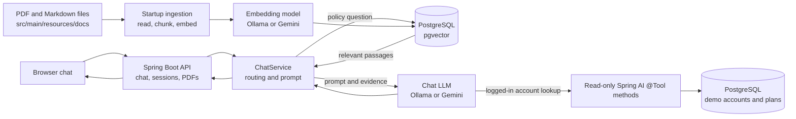

# Telecom AI Chat Bot Demo

This is a small, educational telecom support chatbot built with Java 25, Spring Boot, Spring AI, and PostgreSQL. It answers questions about support policies from the PDFs bundled with the project and can look up read-only account information for one of four demo customers. You can try it as a guest or select a demo customer in the chat.

The app is designed to show how retrieval-augmented generation (RAG), embeddings, a vector database, chat models, and Spring AI tools can work together. The customer records and company are fictional, and the account tools cannot make changes such as recharges or plan changes.

**Live demo:** [https://telecom-chatbot-jk29.onrender.com/](https://telecom-chatbot-jk29.onrender.com/)

## Architecture



### Chat and embedding models

The app uses two different model roles:

| Role | Local profile (`local`, default) | `prod` profile |
|---|---|---|
| Chat model | Ollama `llama3.2:3b` | Gemini `gemini-3.1-flash-lite` |
| Embedding model | Ollama `nomic-embed-text` | Gemini `gemini-embedding-2` |

The **chat model** writes the response and can request an account lookup through a tool. In this demo, Gemini gives more natural and capable conversational answers, so it is the recommended choice for the best visitor experience. The smaller Ollama model is useful for local development and trying the app without a Gemini key; its answers may be less polished.

The **embedding model** turns document passages and a user's question into vectors (lists of numbers) so the app can find text with a similar meaning. PostgreSQL stores both each passage and its vector in a `vector_store` table. pgvector provides the vector storage and similarity search.

Ollama runs on your computer and does not run inside the supplied Docker Compose setup. Install it using the [official Ollama download page](https://ollama.com/download). The app pulls the models from Ollama's model library when you run the `ollama pull` commands in the local setup below. Local model speed depends on your computer's memory and processor/GPU.

The `prod` profile uses Google's Gemini Developer API. Create a key in [Google AI Studio](https://aistudio.google.com/app/apikey) and keep it private. Gemini offers free-tier access to both models used here, which is generally enough for educational use and a small demo; the free tier still has project-specific usage quotas. Google's current [Gemini pricing page](https://ai.google.dev/gemini-api/docs/pricing) lists free usage for Gemini 3.1 Flash-Lite and Gemini Embedding 2. Check [current Gemini API rate limits](https://ai.google.dev/gemini-api/docs/rate-limits) for your project.

### Documents, database, and startup

At startup, Flyway applies the numbered SQL files in `src/main/resources/db/migration`. The migrations create the application tables, enable pgvector, automatically create the `vector_store` table, and add fictional demo records. Hibernate checks that the database schema matches the Java entities; it does not create or update the schema itself.

Document ingestion is the process of preparing the source material for chat: the app reads PDF and Markdown files under `src/main/resources/docs`, splits their text into passages, converts each passage into a list of numbers with the embedding model, and stores the passage and numbers in `vector_store`. When a visitor asks a question, the app converts the question into numbers too, then pgvector finds the closest matching passages. Ingestion runs only when the table is empty. When you change the source files, the vector table needs to be truncated and app needs restart to populate latest data. Documents are also available to visitors from the **Support PDFs** link in the chat page.

When a visitor asks a policy question, the app searches pgvector for relevant passages and sends those passages with the question to the chat model. The response is intended to use the retrieved company information rather than invent policy details.

### What `ChatService` does

`ChatService` handles the main decision-making for a chat request:

- Its `SYSTEM` instructions define the assistant's SkyTel-only scope, response style, privacy rules, and read-only behavior.
- Before calling the LLM, it handles greetings, out-of-scope requests, action requests, guest account questions, and cases where retrieval found no useful information.
- For supported questions, it retrieves relevant document passages and adds them as reference information to the model prompt.
- For a logged-in demo customer, it supplies the account tools and passes the customer ID from the web session as tool context; the model cannot choose another customer's ID.
- Each prompt to the LLM contains the current customer message and, when useful, at most the most recent exchange from that session; a repeated question is sent without the earlier exchange. The service returns a friendly fallback if a provider or tool call fails.

The methods in `AccountTools` use Spring AI's `@Tool` annotation to expose read-only lookups such as balance, usage, transactions, current plan, services, and plan recommendations. A guest can use document answers, but must select a demo customer for account questions. No tool changes account data.

## How to run locally

### Requirements

- Java 25
- Maven 3.x
- Docker Desktop or another Docker Engine, if you want to run the database locally (if you run only with prod profile then you can skip the docker setup part)
- Ollama installed on the host computer for the default `local` profile

If you want a fully local setup, use Option A with Docker PostgreSQL and Ollama. You can skip both the local database and Ollama setup by choosing Option B instead: Neon and Gemini both offer free tiers that work well for an educational demo, and you can run the Spring Boot app locally against them. Free-tier usage quotas apply.

The application itself is not included in the database container. `Dockerfile` builds the Spring Boot application into a Java runtime image. `docker-compose.yml` defines a PostgreSQL/pgvector database and an optional app container, and gives the database a named volume so its data survives container restarts. Ollama remains a separate host application.

### Option A: Local app with a Docker PostgreSQL database

This is the simplest way to learn the default configuration. Start just the database from the project directory:

```bash
docker compose up -d db
```

Install Ollama from [ollama.com/download](https://ollama.com/download), then download the two models used by the local profile:

```bash
ollama pull llama3.2:3b
ollama pull nomic-embed-text
```

Make sure Ollama is running, then start the Spring Boot app on your host computer:

```bash
mvn -s .mvn-settings.xml spring-boot:run
```

The default `local` profile uses Ollama at `http://localhost:11434` and PostgreSQL at `localhost:5432` with the local Compose defaults. Open [http://localhost:8080](http://localhost:8080). On the first run, Flyway creates and seeds the database, then the app reads and embeds the support documents if `vector_store` is empty. Ask a question such as “What plans do you have?” or select a demo customer and ask “What's my balance?”.

To stop the database, run `docker compose down`. The named volume is kept. To remove it and its database contents, you would need to explicitly remove the Compose volume; this is not needed for a normal stop or restart.

### Option B: Run locally with Neon and Gemini

You can skip starting a local database and installing Ollama by using Neon for PostgreSQL and Gemini for both model roles. [Neon has a free tier](https://neon.tech/pricing/) suitable for a small learning or demo project, with usage quotas. Create a Neon project, copy its connection URL, username, and password, and make sure pgvector is available. Neon's compute starts automatically when the app connects, so there is no manual database wake-up step. I have not noticed a database delay while using this demo; Neon may scale free-tier compute to zero after inactivity, so connection behavior can depend on the current plan and usage.

Create a [Gemini API key in Google AI Studio](https://aistudio.google.com/app/apikey), then set the `prod` profile and the connection values in the same terminal before starting the app. For PowerShell:

```powershell
$env:DB_URL = "jdbc:postgresql://YOUR-NEON-HOST/YOUR-DATABASE?sslmode=require"
$env:DB_USER = "YOUR-NEON-USER"
$env:DB_PASSWORD = "YOUR-NEON-PASSWORD"
$env:SPRING_PROFILES_ACTIVE = "prod"
$env:GEMINI_API_KEY = "YOUR-GEMINI-API-KEY"
mvn -s .mvn-settings.xml spring-boot:run
```

Flyway will migrate the Neon database at application startup. The `prod` profile selects Gemini even though the app itself is running on your computer.

### Running the complete app in Docker

`docker compose up --build` builds and starts both the app and database containers. The default local profile expects Ollama at `localhost:11434`, but `localhost` inside the app container is the container itself. If you want the containerized app to use Ollama installed on your host, set `OLLAMA_BASE_URL` to a host-reachable Ollama address (on Docker Desktop, typically `http://host.docker.internal:11434`) in the app service environment before starting it. Alternatively, configure the app container to use the Gemini `prod` profile and provide `GEMINI_API_KEY` and the desired database values. The local-app-with-Docker-database instructions above avoid this extra container networking setup.

## How to deploy live for free

The live demo uses a Render Docker web service for the app and Neon for PostgreSQL. Both providers offer free tiers for small demos, subject to their current quotas and terms.

1. Push the project to GitHub.
2. Create a Neon project, confirm pgvector is available, and copy the connection URL, username, and password. Use a TLS-enabled connection string, such as one with `sslmode=require`. Neon compute starts automatically when the app connects; you do not need to start it manually. On the free tier it can scale to zero after inactivity, though I have not noticed a pause in this demo's usage.
3. In Render, create a **Web Service**, connect your GitHub account, select this repository and the branch to deploy, and choose **Docker** as the runtime. Render builds the app from the repository's [Dockerfile](Dockerfile) and generates an `onrender.com` URL when deployment completes.
4. Set these environment variables in Render:

   | Variable | Value |
   |---|---|
   | `SPRING_PROFILES_ACTIVE` | `prod` |
   | `DB_URL` | Your Neon JDBC URL |
   | `DB_USER` | Your Neon database user |
   | `DB_PASSWORD` | Your Neon database password |
   | `GEMINI_API_KEY` | A key from [Google AI Studio](https://aistudio.google.com/app/apikey) |
   | `SUPPORT_PHONE` | Optional support contact displayed by the demo |

5. Set Render's health check path to `/actuator/health` and create the service. Flyway applies database migrations when the app starts, and document ingestion populates `vector_store` if it is empty. If Gemini rejects embedding requests because of quota or configuration, check the Render logs and your project's API limits.
6. When the deployment finishes, open the URL Render provides for your service. For example, this repository's live demo is [https://telecom-chatbot-jk29.onrender.com/](https://telecom-chatbot-jk29.onrender.com/); your service will have its own URL.

With the repository connected, Render can automatically build and deploy each new commit pushed to the selected branch. This makes publishing updates as simple as pushing the change to GitHub, as long as auto-deploy is enabled.

Render's free web services currently spin down after 15 minutes without inbound traffic, and a cold start can take about a minute. A free UptimeRobot HTTP monitor can periodically request the site to reduce idle spin-down: a request every ten minutes is inside Render's 15-minute idle window. UptimeRobot currently checks its free monitors every five minutes, which is frequent enough for that purpose. This can reduce cold starts, but does not prevent Render from restarting a free service or change the workspace's free instance-hour allowance. See [Render's free service details](https://render.com/docs/free) and [UptimeRobot plans](https://uptimerobot.com/pricing/) for current terms.

## Configuration reference

| Variable | Purpose | Default |
|---|---|---|
| `SPRING_PROFILES_ACTIVE` | Select `local` (Ollama) or `prod` (Gemini) | `local` |
| `DB_URL`, `DB_USER`, `DB_PASSWORD` | PostgreSQL connection | Local Compose database |
| `OLLAMA_BASE_URL` | Ollama API address in the local profile | `http://localhost:11434` |
| `OLLAMA_CHAT_MODEL` | Local chat model | `llama3.2:3b` |
| `OLLAMA_EMBEDDING_MODEL` | Local embedding model | `nomic-embed-text` |
| `GEMINI_API_KEY` | Gemini API key for the `prod` profile | Unset |
| `GEMINI_CHAT_MODEL` | Gemini chat model | `gemini-3.1-flash-lite` |
| `GEMINI_EMBEDDING_MODEL` | Gemini embedding model | `gemini-embedding-2` |
| `VECTOR_DIMENSIONS` | pgvector and Gemini embedding dimensions | `768` |
| `SUPPORT_PHONE` | Contact included in support fallbacks | `1800-000-0000` |
| `PORT` | HTTP port | `8080` |
| `AI_TIMEOUT_SECONDS` | Maximum wait for a chat provider response | `45` |
| `RAG_TOP_K`, `RAG_THRESHOLD` | Number of retrieved passages and similarity cutoff | `5`, profile default |
| `RATE_LIMIT_PER_MINUTE`, `RATE_LIMIT_PER_DAY` | Per-IP request caps | `10`, `50` |

When changing profiles from Ollama to Gemini, the embedding model changes too, so the existing vectors in `vector_store` were created by a different model and should not be mixed with the new ones. Before restarting with the new embedding model, clear the vectors with `TRUNCATE TABLE vector_store;` on the database the app uses. On restart, document ingestion sees the empty table and repopulates it using the currently selected embedding model. You do not need to clear the table when only changing the chat model. If you change embedding dimensions, also make sure the pgvector column dimension matches `VECTOR_DIMENSIONS`.
