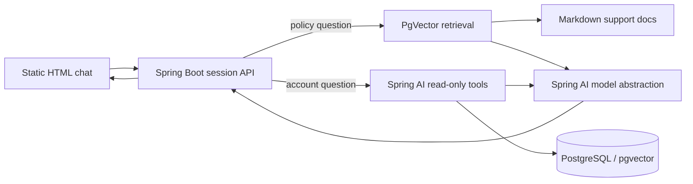

# SkyTel Read-only Support Demo

A small, fictional Java 21/Spring Boot 3 demo. It answers company policy questions from local documents using retrieval augmented generation (RAG), and personal questions with read-only tools scoped to the logged-in demo customer. Sample records are fake. No action endpoints exist.

## Architecture



### RAG, tools and fallback

At startup the app chunks support Markdown into overlapping passages and embeds them only if `vector_store` is empty. Retrieval uses configurable top-K and similarity threshold. The model is instructed to ground plan/policy answers only in retrieved passages and treats both user text and document content as untrusted. Each answer includes source file names.

Account data is exposed through read-only `@Tool` methods. The customer ID is placed in Spring AI `ToolContext` from the HTTP session, never accepted as a model argument. Guests may use document answers only. Requests to perform actions short-circuit to: `I'm not able to do that here. Please contact SkyTel support at {support.phone}.` If an action's documented process is useful, the bot can explain it, while still making clear it has not performed it and directing the visitor to support. Tool/provider failures return the same friendly fallback; stack traces are not sent to the browser.

## Run locally

Requirements: Java 21, Maven 3.9+, Docker, and Ollama.

```bash
docker compose up -d db
ollama pull qwen3:4b
ollama pull nomic-embed-text
mvn -s .mvn-settings.xml spring-boot:run
```

Open `http://localhost:8080`. Flyway creates the schema and fake data. The default support phone `1800-000-0000` is fake and clearly labelled as a demo. You can override it with `SUPPORT_PHONE`.

## Deploy free (example)

1. Create a Neon PostgreSQL database with the pgvector extension available. Copy its JDBC URL, username and password into `DB_URL`, `DB_USER`, and `DB_PASSWORD`; use `sslmode=require` in the JDBC URL. Neon can suspend while idle; Hikari uses a four-connection maximum, short connection timeout, validation query, and Flyway startup retries to tolerate wake-up delays.
2. Create a Render Web Service from this repository and select Docker. Configure `SPRING_PROFILES_ACTIVE=prod`, `DB_URL`, `DB_USER`, `DB_PASSWORD`, `GEMINI_API_KEY`, and optionally `SUPPORT_PHONE`. Use `/actuator/health` as the Render health check path. The container reads Render's `PORT` and uses `-Xmx300m -XX:+UseSerialGC` for a 512 MB host.
3. First startup may take a minute while the database wakes and initial docs are embedded. If the provider limits requests, startup logs a warning and remains available; rerun after fixing configuration to complete ingestion.

Gemini chat and embeddings are behind Spring AI interfaces. Gemini embeddings are explicitly set to 768 dimensions to match the default pgvector column. If you change embedding provider or dimension, truncate `vector_store` and restart so documents are re-ingested; vectors from different models cannot be mixed.

## Environment variables

| Variable | Purpose | Default |
|---|---|---|
| `SPRING_PROFILES_ACTIVE` | `local` or `prod` | `local` |
| `DB_URL`, `DB_USER`, `DB_PASSWORD` | PostgreSQL JDBC and credentials | local compose defaults |
| `GEMINI_API_KEY` | Gemini Developer API key, prod only | unset |
| `GEMINI_CHAT_MODEL` | Gemini chat model | `gemini-2.5-flash-lite` |
| `GEMINI_EMBEDDING_MODEL` | Gemini embedding model | `text-embedding-004` |
| `VECTOR_DIMENSIONS` | pgvector and Gemini embedding dimensions | `768` |
| `SUPPORT_PHONE` | Fake demo contact | `1800-000-0000` |
| `PORT` | HTTP port | `8080` |
| `AI_TIMEOUT_SECONDS` | Maximum wait for a chat provider response | `45` |
| `RAG_TOP_K`, `RAG_THRESHOLD` | Retrieval controls | `5`, `0.55` |
| `RATE_LIMIT_PER_MINUTE`, `RATE_LIMIT_PER_DAY` | Per-IP request caps | `10`, `50` |

## Example questions

Try “What plans do you have?”, “What's my balance?”, “Why was I charged yesterday?”, “How do I deactivate my SIM?”, and “Suggest a cheaper plan”. Guest users are prompted to log in before account questions. Four one-click fake customer profiles are provided in the UI.

## Limitations

This is an educational read-only demo with in-memory sessions, per-process rate limits, and fake Indian-rupee sample records. It is not suitable for production customer data. Markdown and PDF files placed in `src/main/resources/docs/` are ingested. The support contact is fake. Spring AI 1.1.8 is the latest stable line compatible with the requested Spring Boot 3.x; Spring AI 2.0.1 targets Spring Boot 4.x.

## Try it live

<link>
